### Задача 1. Антивирусное ПО

**Описание:**  
В соответствии с альтернативным вариантом, разрешенным методическими рекомендациями к аттестации, для изучения было выбрано антивирусное решение **Kaspersky Free для macOS**.
Поскольку установка стороннего ПО на личное устройство не требовалась, были изучены официальные материалы разработчика, подтверждающие наличие требуемого функционала:

1. Наличие модуля защиты в реальном времени.
2. Настройка автоматического обновления антивирусных баз.
3. Возможность запуска полного сканирования системы.

**Скриншоты из официальной документации:**  
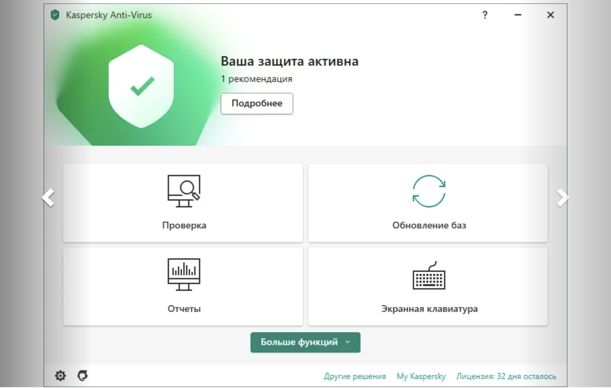  
_Рисунок 1. Описание функции защиты в реальном времени на официальном сайте_

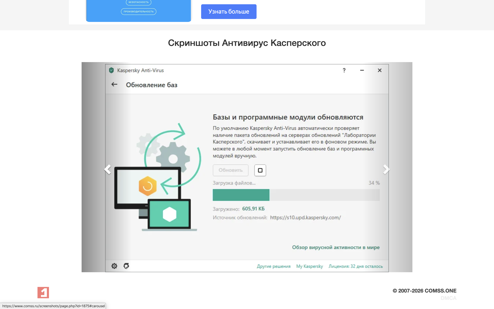  
_Рисунок 2. Информация об автоматическом обновлении баз_

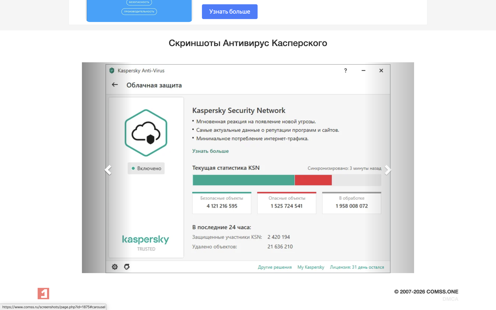  
_Рисунок 3. Описание функции полного сканирования системы_

**Обоснование выбора:**  
Выбор пал на данное решение, так как оно соответствует рекомендациям ФСТЭК, имеет прозрачную политику бесплатного использования для частных лиц и предоставляет весь необходимый функционал для базовой защиты рабочей станции без избыточного потребления ресурсов.

### Задача 2. Пароль и двухфакторная аутентификация (2FA)

**Описание:**

1. **Создание пароля:** С помощью генератора паролей был создан стойкий пароль длиной 16 символов, включающий заглавные и строчные буквы, цифры и специальные символы, что полностью соответствует требованиям политики безопасности.
2. **Настройка 2FA:** Двухфакторная аутентификация была успешно настроена для учетной записи Яндекс ID. В разделе «Безопасность» был выбран метод «Приложение для генерации кодов» (стандарт TOTP). QR-код был отсканирован с экрана компьютера с помощью мобильного приложения Google Authenticator, после чего введен проверочный 6-значный код для завершения привязки.

**Скриншоты:**  
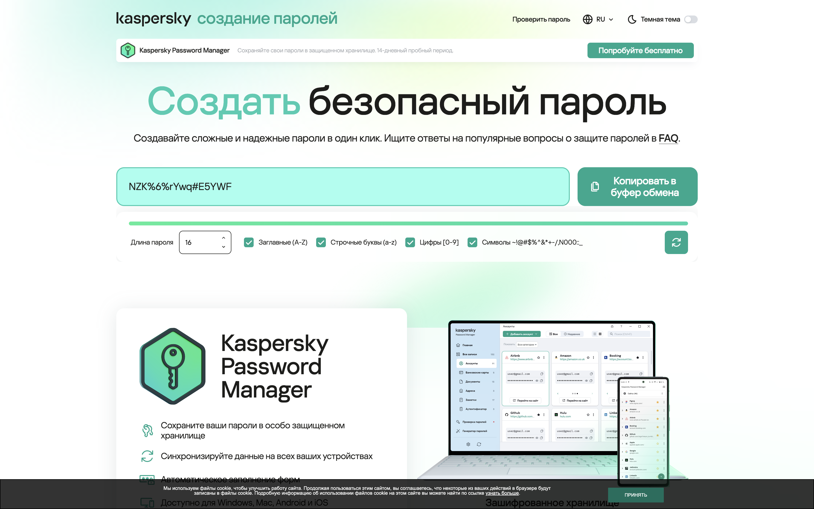  
_Рисунок 4. Генерация стойкого пароля, соответствующего требованиям сложности_

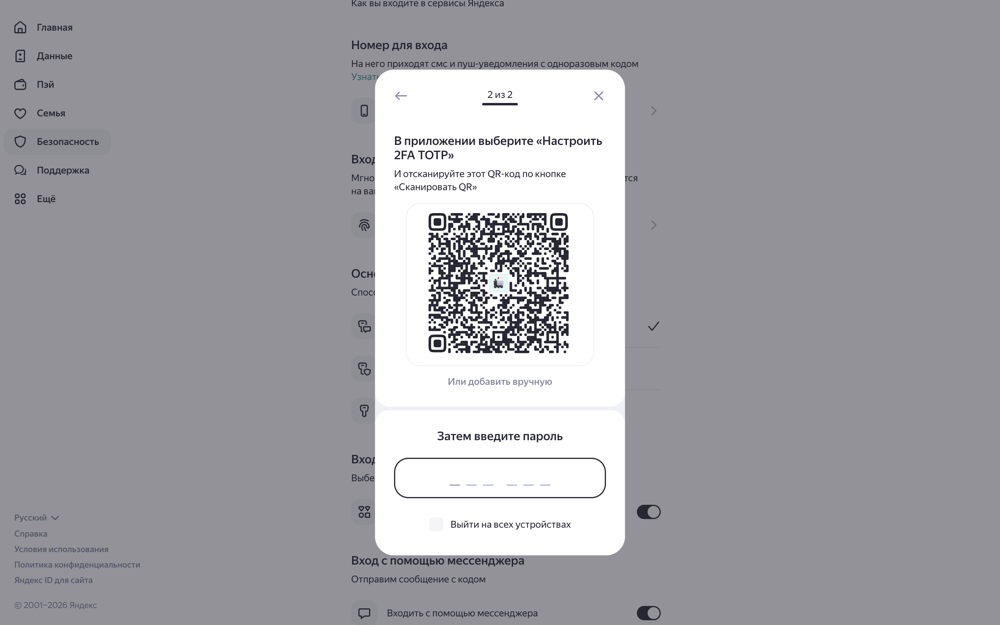  
_Рисунок 5. Экран настройки аккаунта с QR-кодом для привязки приложения_

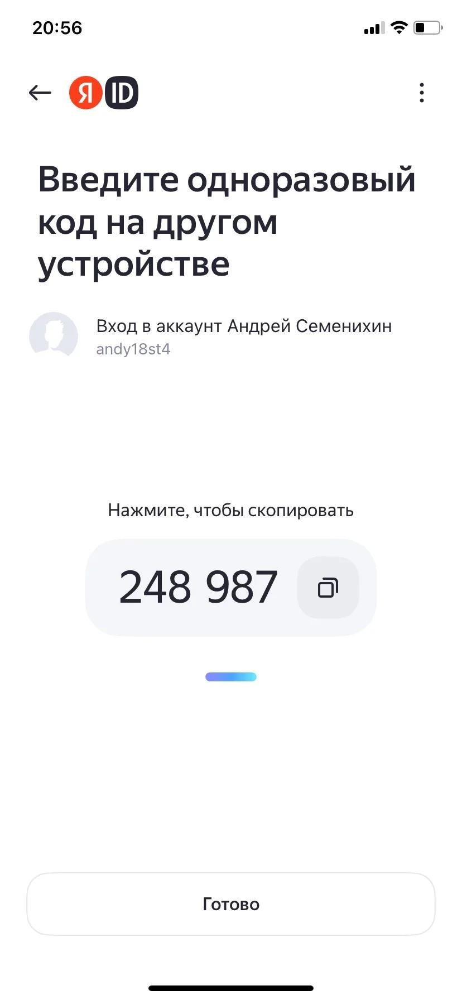  
_Рисунок 6. Успешно добавленный аккаунт в мобильном приложении Google Authenticator_

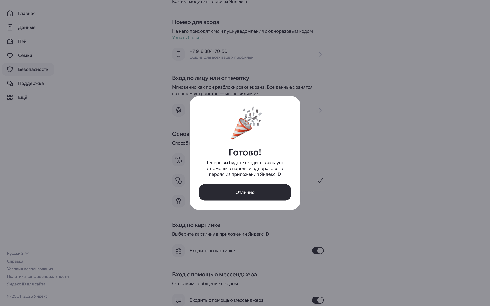  
_Рисунок 7. Подтверждение успешного включения двухфакторной аутентификации_

**Обоснование выбора:**  
Использование генератора исключает человеческий фактор и уязвимости, связанные с предсказуемыми паролями. В качестве средства 2FA выбран Google Authenticator, так как это бесплатное, кроссплатформенное приложение, реализующее открытый стандарт TOTP. Это надежно защищает аккаунт от несанкционированного доступа даже в случае компрометации основного пароля и полностью соответствует рекомендациям методических материалов.

### Задача 3. Проверка безопасности работы в интернете (Настройка браузера)

**Описание:**  
Настройка выполнена в браузере Яндекс.Браузер на ОС macOS.

1. В разделе «Пароли и карты» отключены функции сохранения паролей и автоматического заполнения форм.
2. В разделе «Сайты» в блоке «Файлы cookie» активирована опция «Блокировать сторонние файлы cookie».

**Скриншоты:**  
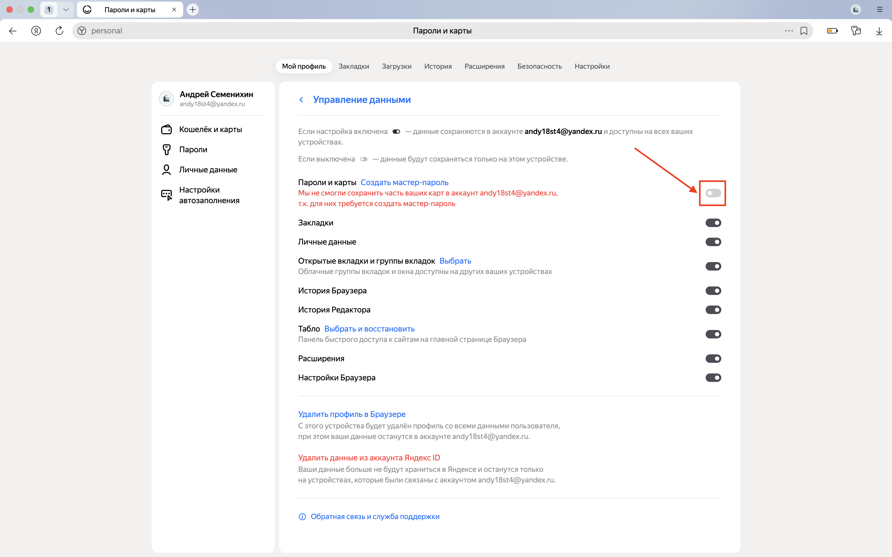  
_Рисунок 8. Отключение сохранения паролей и автозаполнения форм в Яндекс.Браузере_

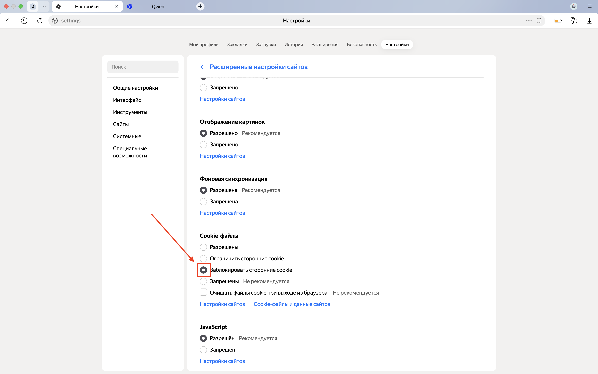  
_Рисунок 9. Активация блокировки сторонних файлов cookie в настройках сайтов_

**Обоснование:**  
Отключение автозаполнения предотвращает риск автоматической подстановки учетных данных на фишинговых или скомпрометированных сайтах. Блокировка сторонних cookies ограничивает межсайтовое отслеживание (трекинг) действий пользователя и снижает риск кражи сессионных идентификаторов (Session Hijacking), что напрямую повышает конфиденциальность при серфинге.

### Задача 4. Шифрование данных

**Описание:**  
Для шифрования данных был выбран кроссплатформенный инструмент с открытым исходным кодом **VeraCrypt**. В целях безопасности личного устройства (во избежание рисков при полном шифровании системного диска) был реализован метод работы с зашифрованным файловым контейнером:

1. Создан стандартный зашифрованный контейнер объемом 100 МБ с использованием алгоритма AES и хэш-функции SHA-512.
2. Для защиты тома был задан стойкий пароль (`V3ryS3cur3!Pass`), соответствующий требованиям сложности (заглавные и строчные буквы, цифры, спецсимволы).
3. В главном интерфейсе программы выбран путь к созданному файлу-контейнеру (см. Рисунок 10).
4. Том успешно смонтирован в систему (см. Рисунок 11). Для проверки работоспособности шифрования на смонтированном виртуальном диске (`untitled`) был создан тестовый файл `secret.txt` (см. Рисунок 12).
5. После размонтирования тома, в соответствии с правилами информационной безопасности, создана резервная копия файла-контейнера (имитация правила резервного копирования 3-2-1, см. Рисунок 13).

**Скриншоты:**  
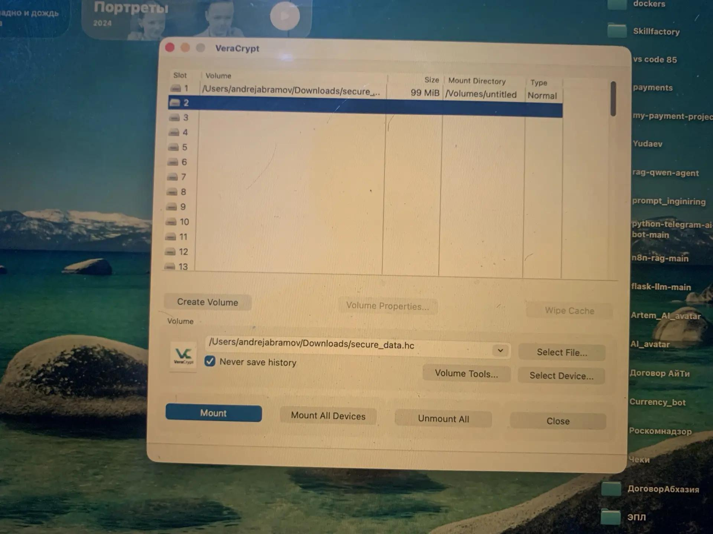  
_Рисунок 10. Главный интерфейс VeraCrypt: файл-контейнер выбран в строке пути и готов к монтированию_

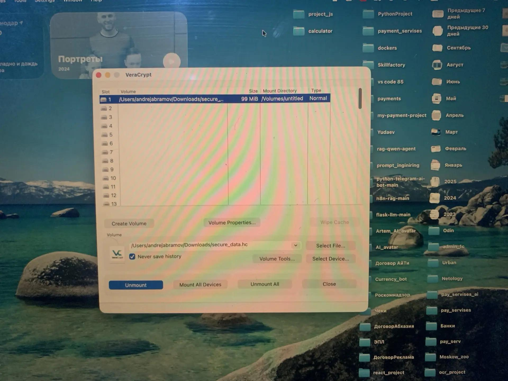  
_Рисунок 11. Файл-контейнер успешно смонтирован в слот программы_

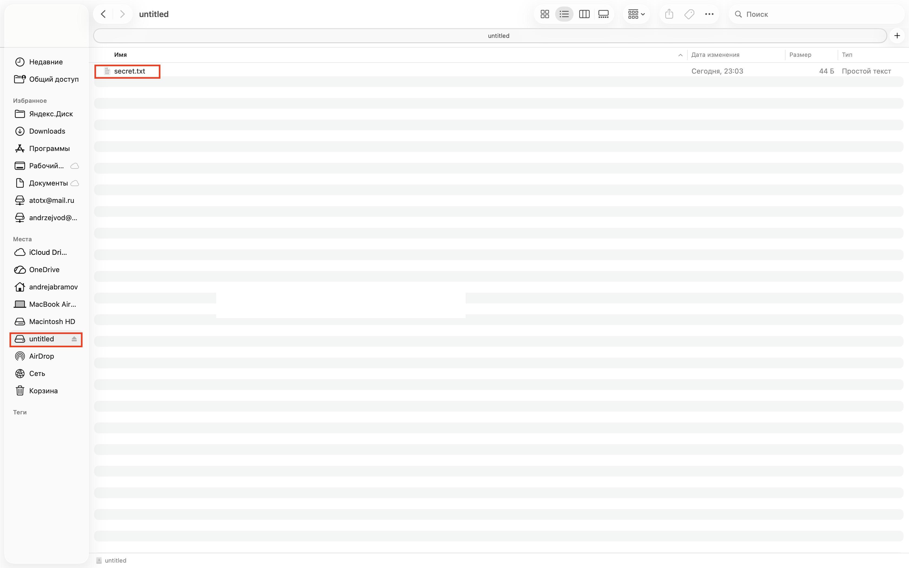  
_Рисунок 12. Смонтированный виртуальный диск `untitled` с созданным внутри тестовым файлом `secret.txt`_

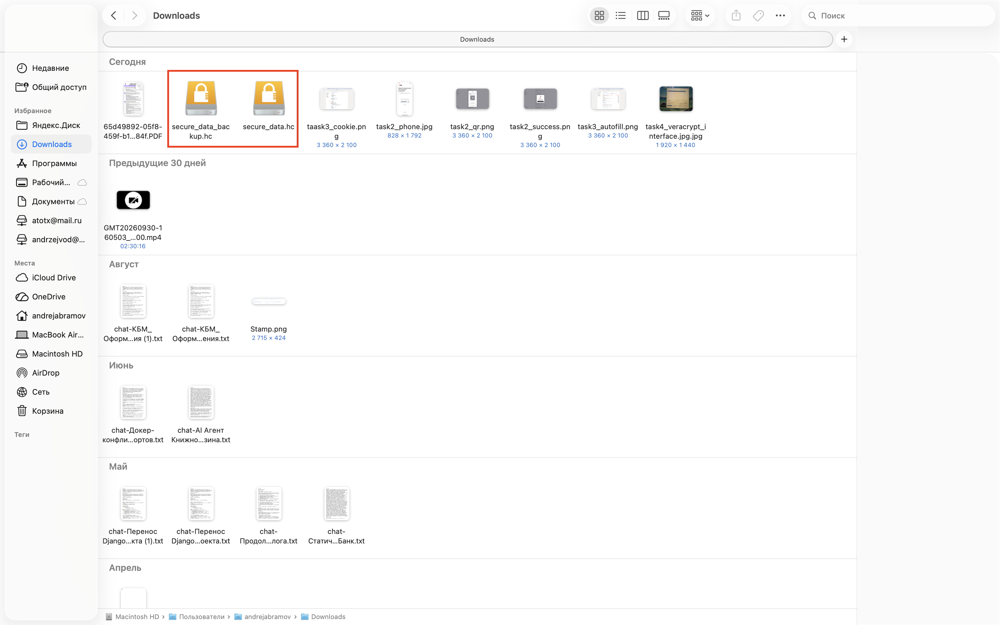  
_Рисунок 13. Создание резервной копии зашифрованного файла (`secure_data_backup.hc`) в файловой системе_

**Обоснование:**  
VeraCrypt выбран как надежное, бесплатное решение с открытым исходным кодом. Работа с файловым контейнером безопаснее полного шифрования системного диска для личного устройства, так как исключает риск потери доступа к операционной системе при сбое, а наличие резервной копии гарантирует сохранность данных в случае повреждения основного носителя.
